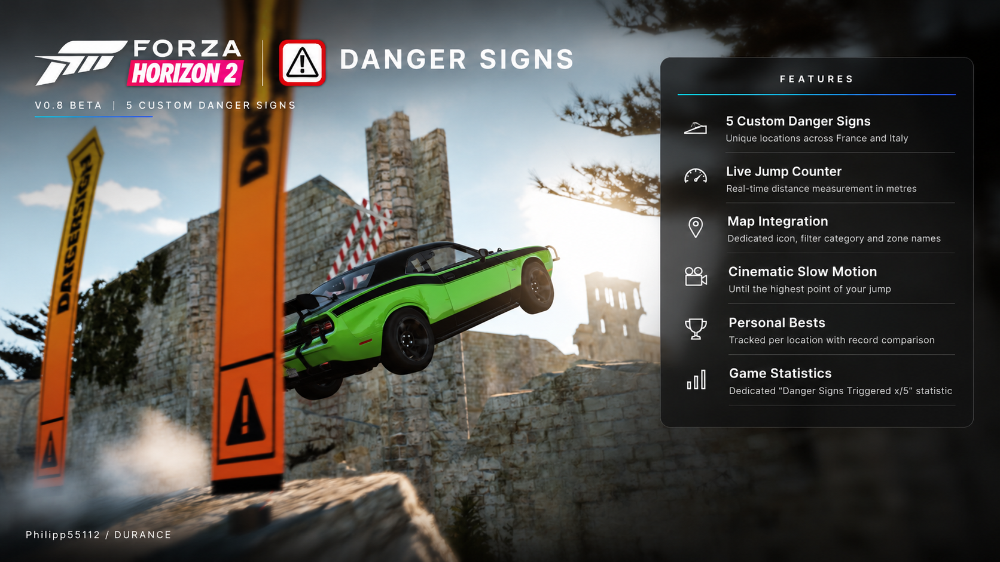

<div align="center">

  

  **Bring the Danger Sign experience from Forza Horizon 3 to Forza Horizon 2!**

  
  
  
  

</div>

# Forza Horizon 2 – Danger Signs

Danger Signs introduces five fully integrated jump challenges to the open world of Forza Horizon 2 on PC.

Inspired by the Danger Signs introduced in Forza Horizon 3, this modification brings custom ramps, accurate jump detection, live distance tracking, Personal Bests and cinematic slow motion directly into the original game.

These are not external overlays or visual additions. Every Danger Sign is implemented as an actual in-game activity, featuring its own map icon, dedicated map filter, localized name, activation logic and results presentation.

The goal is to recreate the original Danger Sign experience as closely as possible while extending the capabilities of the Forza Horizon 2 engine.

**Find your ramp, hit the jump and see how far you can fly!**

---

## 🚀 Features

### 🏁 5 Custom Danger Signs

Five individually designed Danger Signs are distributed across France and Italy.

| # | Danger Sign | Location |
|---|---|---|
| 01 | Vaux-de-Cernay | France |
| 02 | Aérodrome | France |
| 03 | Field Bend | France |
| 04 | San Giovanni | Italy |
| 05 | Tenuta Montellino | Italy |

Every location has its own custom ramp, activation area, environmental decorations and jump detection.

All five activities are available directly through the world map.

### 🗺️ Full Game Integration

Danger Signs are integrated into the existing Forza Horizon 2 world map and activity system.

- Dedicated Danger Sign map icons.
- Separate **Danger Signs** map filter category.
- Individual localized activity names.
- In-game **DANGER SIGN** banner when approaching an active ramp.
- Dedicated activation and jump detection logic.
- Integrated jump results presentation.
- Dedicated progression statistics.

### 🎯 Precise Ramp Detection

Jump detection is tied directly to the actual ramp geometry.

The activity triggers precisely at the edge of the ramp, but only when the vehicle passes between the designated flags.

- Correct approach through the flags is required.
- Detection happens at the actual ramp edge.
- Driving past the ramp without hitting the trigger does not activate the activity.
- Missing the designated activation area will not register a jump.

This ensures that jumps are only registered when the ramp is approached correctly.

### 📏 Jump Distance & Personal Bests

Every jump is measured directly by the game.

**Live Jump Counter**
- Displays the current jump distance while airborne.
- Updates continuously during the flight.
- Measures the distance in metres.

**Final Results**
- Displays the completed jump distance after landing.
- Compares the result against your existing Personal Best.

**Personal Best System**
- Individual records for all five Danger Signs.
- Automatically tracks your longest jump.
- Record comparison similar to the existing Speed Zone system.

### 🎬 Cinematic Slow Motion

Every successful jump features a dedicated cinematic slow-motion sequence.

- Slow motion begins during the jump.
- Continues until the vehicle reaches its highest point.
- Normal game speed automatically resumes afterwards.
- Dedicated slow-motion audio synchronized with the effect.
- Audio pauses correctly when opening the pause menu.
- Sound resumes when returning to gameplay.

The intention is to recreate the cinematic feeling of Danger Signs from newer Horizon titles.

### 🌐 Multiplayer Compatibility

Danger Signs also account for the limitations of multiplayer gameplay.

- Slow motion is automatically disabled in FH2MP.
- Jump detection remains fully functional.
- Distance measurement continues to work.
- No forced slow-motion effects for other players.

### 🚩 Authentic FH3-Inspired Ramp Decorations

The ramps feature custom environmental props inspired by Forza Horizon 3.

- Animated cloth flags with wind effects.
- Physical flag objects.
- Round barrel-style flag bases.
- Road barriers surrounding the ramps.
- Additional traffic cones and environmental decorations.

Every location has individually placed props to make the ramps feel like proper Horizon Festival activities.

### 📊 Statistics & Progression

Danger Signs feature their own dedicated statistic in the game's statistics menu.

**Danger Signs Triggered: x/5**

- Tracks activated Danger Signs.
- Separate statistic from existing activities.
- Integrated directly into the game's statistics system.

### 🌍 Localization

Danger Signs includes localization for 14 languages.

Activity names, banners and associated text are adapted to the supported game languages.

---

## 🎮 Gameplay Behaviour

### Jump Activation

The jump detection system uses the designated ramp position and activation flags.

A successful activation requires the vehicle to pass through the correct trigger area at the ramp edge.

Simply driving past or jumping near a ramp will not automatically trigger the activity.

### Slow Motion Behaviour

The cinematic slow-motion sequence is tied to the vehicle's jump progression.

The effect continues until the highest point of the jump, where the game automatically returns to normal speed.

The dedicated audio system follows the same behaviour and correctly handles the game's pause menu.

### Event Compatibility

Danger Signs are automatically suspended during active game events.

This includes:

- Races
- Showcases
- Other active events

Activities become available again when returning to Freeroam.

---

## ⚙️ Configuration

Additional settings are available through `DangerSigns.ini`.

| Setting | Description |
|---|---|
| `sound` | Enables or disables slow-motion audio. |
| `log=1` | Enables diagnostic logging. |
| `record=1` | Enables the jump recorder. |

### Jump Recorder

The built-in jump recorder is primarily intended for development and discovering suitable locations for future Danger Signs.

Set:

```ini
record=1
```

The recorder helps collect jump-related data when evaluating potential new ramp locations.

### Debug Logging

For troubleshooting, logging can be enabled using:

```ini
log=1
```

The plugin generates a `DangerSigns.log` file containing diagnostic information.

When reporting bugs, please include this file whenever possible.

---

## 🔧 Technical Implementation

Danger Signs uses dedicated runtime functionality to integrate custom activities into Forza Horizon 2.

The modification extends several aspects of the original game:

| Component | Responsibility |
|---|---|
| Activity Integration | Custom Danger Sign definitions and activation logic |
| Jump Detection | Ramp-edge detection and activation validation |
| Distance Tracking | Live jump measurement and final results |
| Slow Motion | Cinematic speed control and audio synchronization |
| Map Integration | Custom icons, filter category and activity names |
| Statistics | Dedicated Danger Sign progression |
| Environmental Props | Custom flags, barriers and ramp decorations |
| Jump Recorder | Recording data for potential future locations |

### Runtime Loading

All components are loaded through the Azimuth runtime and FH2 Extra Options.

- Original game files remain untouched.
- No permanent modifications to the game installation are required.
- Custom functionality is handled through runtime mod loading.
- The modification can be removed by deleting its installed mod folder.

---

## 📦 Compatibility & Requirements

| Component | Requirement |
|---|---|
| Game | Forza Horizon 2 |
| Platform | PC |
| Runtime | Azimuth |
| Mod Loader | FH2 Extra Options |

**Required:**
- A working Forza Horizon 2 PC installation.
- Azimuth.
- FH2 Extra Options with runtime mod loading enabled.

This modification is specifically designed for Forza Horizon 2 running through Azimuth.

---

## 📥 Installation

1. Download the latest Danger Signs release package.
2. Extract the downloaded ZIP archive.
3. Open your FH2 Extra Options mod directory.
4. Copy the complete `DangerSigns` mod folder into the mod directory.
5. Keep the original folder structure intact.
6. If you are also using Drift Zones, configure the correct load order.

### Load Order

When using both modifications, Danger Signs must load after Drift Zones.

Open:

`mods\Forza Horizon 2\loadorder.txt`

Make sure the entries look like this:

```text
DriftZones
DangerSigns
```

7. Launch Forza Horizon 2 through Azimuth.

The five Danger Signs will be available directly on the world map.

---

## 🗑️ Uninstallation

Removing Danger Signs is straightforward.

1. Close Forza Horizon 2.
2. Open your FH2 Extra Options mod directory.
3. Delete the `DangerSigns` folder.
4. Restart the game.

No original game files need to be restored or replaced.

---

## ⚠️ Known Issues – Beta 0.8

- **Flag Bases:** The barrel-style flag bases can currently be displaced by vehicle collisions.

This is a known limitation of the current beta and may be improved in future updates.

---

## 🛠️ Development & Future Plans

Danger Signs is part of a larger effort to bring features from newer Forza Horizon titles into Forza Horizon 2.

The project explores the limits of the original game engine and extends its capabilities wherever possible.

Current development focuses on:

- Additional Danger Sign locations.
- Improved environmental prop placement.
- Further cloth physics and animation refinements.
- Improvements to jump detection and activity behaviour.
- Additional visual details inspired by newer Horizon titles.

Community feedback and suggestions for new locations are always welcome.

---

## 💬 Feedback & Bug Reports

This is an early beta release, and community feedback is especially valuable.

If you discover bugs, have suggestions or find interesting locations for future Danger Signs, feel free to share them.

When reporting a bug, please include:

- The affected Danger Sign location.
- A description of what happened.
- Your Azimuth and FH2 Extra Options versions.
- Your `DangerSigns.log` file (enable `log=1`).
- Screenshots or video footage, if available.

**[Open an Issue](https://github.com/Philipp55112/fh2-danger-signs/issues)**

**[Download Latest Release](https://github.com/Philipp55112/fh2-danger-signs/releases)**

---

## ❤️ Credits

**Created and developed by Philipp55112.**

Special thanks to all Alpha Testers and community members who helped test the project, provided feedback and helped push the limits of what is possible in Forza Horizon 2.

---

## ⚖️ Disclaimer

Danger Signs is an unofficial community-made modification.

It is not affiliated with, endorsed by or supported by Microsoft, Xbox, Playground Games or Turn 10 Studios.

Forza Horizon 2 and all related game assets, names and trademarks belong to their respective owners.

Use this modification at your own risk.

---

**© 2026 Philipp55112. All rights reserved.**
